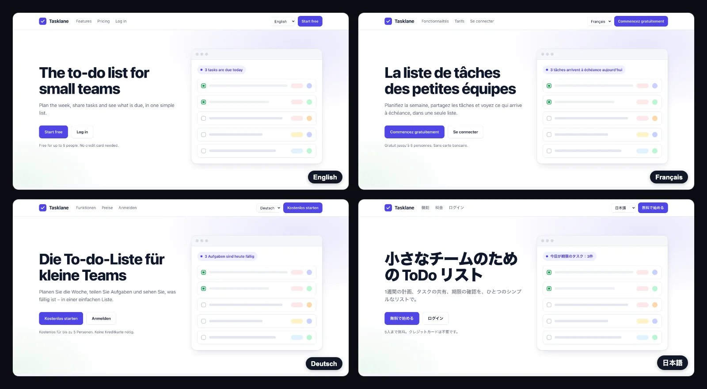

# Babelize examples

Real apps localized with [Babelize](https://www.babelize.co), with nothing hidden. Every example keeps the full history: the app before localization, the **unedited** Babelize run, and the fixes we made in review. Click through the commits to see exactly what the CLI changes and what a human still had to fix.



## What one run does

`npx babelize translate --to fr,de,ja` finds the hardcoded text, sets up an i18n library, writes the locale files and translates them. This is part of [the real diff](https://github.com/babelize/examples/commit/d63ae53) from the Next.js example:

```diff
+import { useTranslations } from "next-intl";
+
 export function Header() {
+  const t = useTranslations();
   return (
     <header>
-      <a href="/" className="logo" aria-label="Tasklane home">
+      <a href="/" className="logo" aria-label={t("header.tasklaneHome")}>
       ...
-        <a href="#features">Features</a>
-        <a href="#pricing">Pricing</a>
+        <a href="#features">{t("header.features")}</a>
+        <a href="#pricing">{t("header.pricing")}</a>
```

In the same run it wrote `public/locales/{en,fr,de,ja}.json`, added the next-intl setup, and saved a lockfile so the next run only translates new or changed strings.

## Examples

| Example | Stack | i18n library it sets up | Babelize run | Review fixes |
|---|---|---|---|---|
| [nextjs-app-router](./nextjs-app-router) | Next.js 16 App Router | next-intl | [`d63ae53`](https://github.com/babelize/examples/commit/d63ae53) | [`348eb7d`](https://github.com/babelize/examples/commit/348eb7d) |
| [static-html](./static-html) | Plain HTML, no build step | Babelize's small `i18n.js` runtime | [`e90e43b`](https://github.com/babelize/examples/commit/e90e43b) | [`425fd6c`](https://github.com/babelize/examples/commit/425fd6c) |

Coming next:

- [React + Vite](https://github.com/babelize/examples/issues/1) (react-i18next), in progress
- [Django](https://github.com/babelize/examples/issues/2) (gettext)
- [Vue 3 + Vite](https://github.com/babelize/examples/issues/3) (vue-i18n, beta)
- [Expo / React Native](https://github.com/babelize/examples/issues/4) (beta)
- [React SDK with the Vite plugin](https://github.com/babelize/examples/issues/5)

## Try it on your own app

```bash
cd your-app
npx babelize translate --to fr,de,ja
git diff
```

It needs a git repo with a clean working tree. It writes everything to your working tree and leaves the review to you. React, Next.js, Django and static HTML are supported; Vue and React Native are in beta. See the [CLI docs](https://docs.babelize.co/cli/translate).

## About the translations

These runs used Babelize's hosted translation: signed in, with no LLM key of our own. That is an open-source machine-translation model we host, not an LLM, and the raw output shows its limits: it translated the brand name, read "Main" (a navigation label) as a word to translate literally, and dropped "Thanks!". The review commits fix all of that by hand.

For better first drafts, use your own LLM key. No account is needed:

```bash
export ANTHROPIC_API_KEY=...   # or OPENAI_API_KEY, GEMINI_API_KEY, GROQ_API_KEY, OPENROUTER_API_KEY
npx babelize translate --to fr,de,ja
```

Either way, review the diff before you merge.

These examples were generated with @babelize/cli 1.3.9. Since 1.3.10, a re-run keeps translations you corrected in the locale files. One known issue remains: a re-run wraps the brand name "Tasklane" again, so check `git diff` after a re-run and discard that change.

## Contribute an example

Each issue above describes the recipe: build the Tasklane page in that stack, commit it, run Babelize, commit the output unedited, then commit your review fixes and a README. Pick one that isn't taken, comment on it, and we'll assign it to you. A free [Babelize account](https://app.babelize.co) covers the run, and if you get stuck or run out of credits, tell us on the issue.

Found a problem in an example? [Open an issue](https://github.com/babelize/examples/issues).

## Links

- [CLI docs](https://docs.babelize.co/cli/translate)
- [How Babelize turns hardcoded strings into a reviewed pull request](https://www.babelize.co/blogs/how-babelize-localizes-nextjs-app/)
- [The best i18n libraries for every framework in 2027](https://www.babelize.co/blogs/best-i18n-libraries-2027/)
- [Elements: ready-made language switchers](https://elements.babelize.co)
